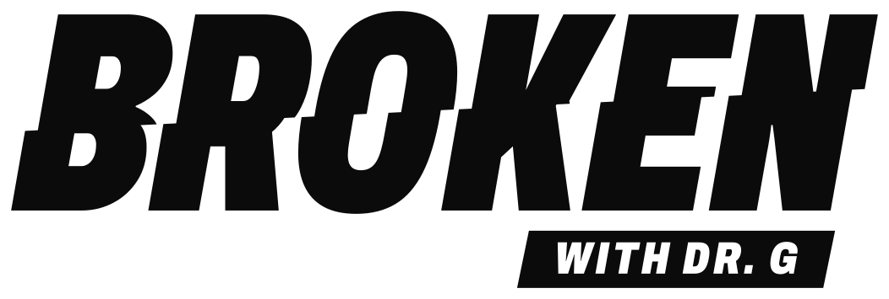
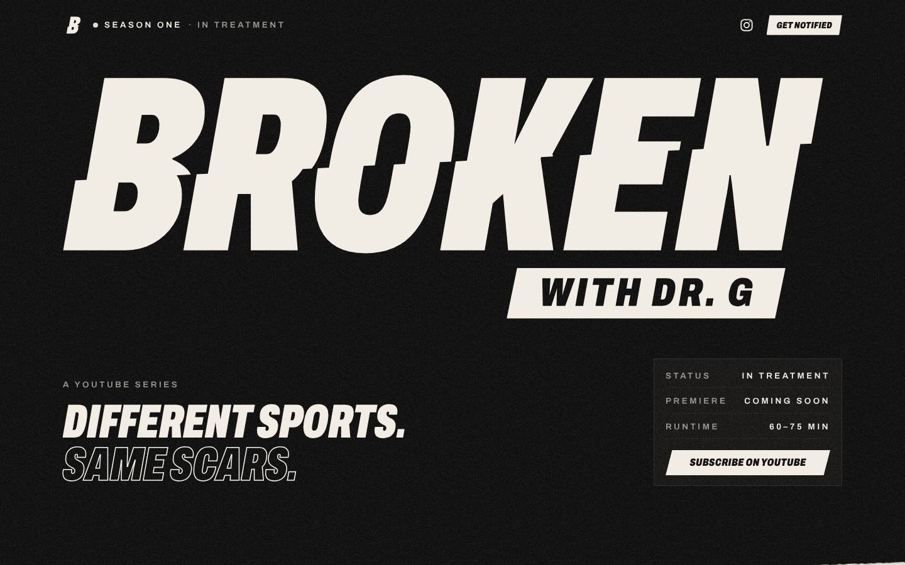
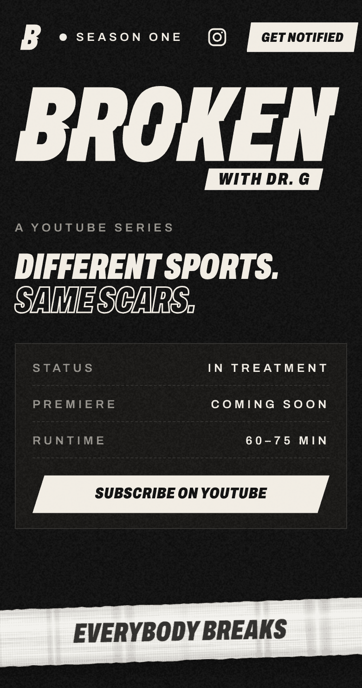
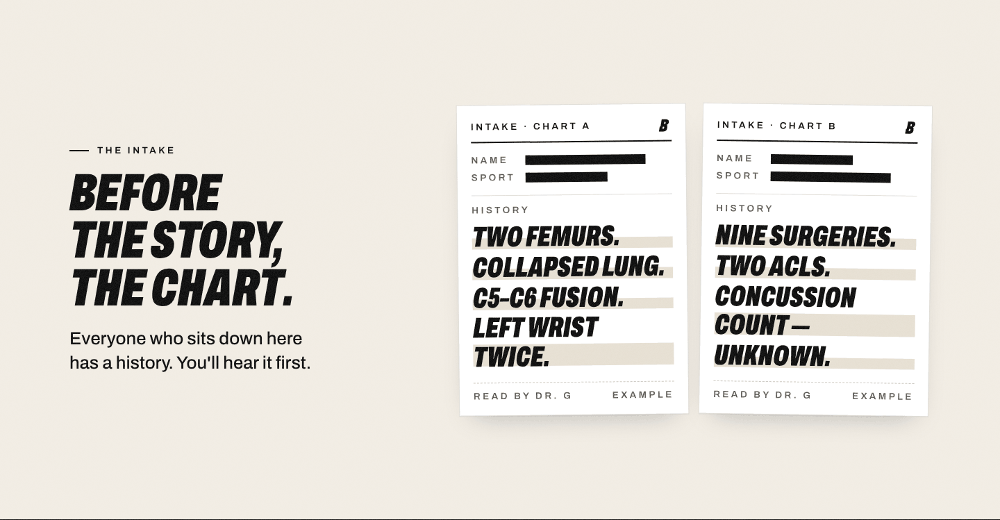

<p align="center">
  <a href="https://www.brokenwithdrg.com">
    <picture>
      <source media="(prefers-color-scheme: dark)" srcset="docs/logo-bone.svg">
      
    </picture>
  </a>
</p>

<p align="center"><strong>Everybody breaks. Different sports. Same scars.</strong></p>

<p align="center">
  The coming-soon site for <em>BROKEN with Dr. G</em>, a YouTube series.<br>
  <a href="https://www.brokenwithdrg.com"><strong>www.brokenwithdrg.com</strong></a> ·
  <a href="https://www.instagram.com/brokenwithdrg/">@brokenwithdrg</a>
</p>

<p align="center">
  
  
  
</p>

---

<p align="center">
  
</p>

<table>
  <tr>
    <td width="34%" valign="top"></td>
    <td valign="top"></td>
  </tr>
</table>

## The page

A single dark landing page built from the brand kit: ink and bone, Archivo, the snapped B. Top to bottom:

| Section | What it does |
|---|---|
| **Hero** | Full primary lockup, "Different sports. Same scars." and a status card with premiere and runtime. |
| **The tape** | A strip of athletic tape rolling across the screen. Tap it and it tears where you touched it, with a synthesized tape-tear sound: the show's audio ID. |
| **The Intake** | Two example intake charts with names and sports redacted. The history lines highlight as they scroll into view. |
| **Why this exists** | "Action sports are tribal." The case for one table, many sports. |
| **The question** | "How have you overcome being broken?" Asked of every guest. |
| **Subscribe + sponsors** | The YouTube call to action, and a direct line for sponsors by Instagram DM. |

It's hand-written HTML, CSS and a little vanilla JavaScript: no framework, no build dependencies, no tracking. Motion respects `prefers-reduced-motion`, and the layout is checked at 390px and 1440px.

## Editing

Every change starts in **`src/template.html`**. Don't edit `public/index.html` directly; it's generated.

```bash
python3 src/build.py     # regenerates public/ from src/
```

Then commit and push to `main`. Vercel deploys every push to production in about a minute.

### Launch settings

At the top of the script in `src/template.html`:

```js
const CHANNEL_URL = "";   // YouTube channel URL. Turns on the subscribe buttons and the header YouTube icon.
const PREMIERE = "";      // ISO date, e.g. "2027-01-15T17:00:00Z". Turns the premiere field into a live countdown.
```

Left empty, the page falls back to "Channel opens soon" and "Coming soon".

### Preview locally

```bash
python3 src/build.py && python3 -m http.server 8000 --directory public
# then open http://localhost:8000
```

## Repository layout

```
.
├── public/                  What Vercel serves (generated by src/build.py)
│   ├── index.html
│   ├── og-image_1200x630.png    Share card for iMessage, Instagram, X and others
│   └── favicon.ico, favicon-32x32.png, apple-touch-icon.png
├── src/
│   ├── template.html        The page: markup, styles, script. Edit this.
│   ├── build.py             Inlines the logo, adds the <head> metadata, writes public/
│   └── brand/               Logo SVGs and icons from the brand kit
├── docs/                    README images (not deployed)
└── vercel.json              Serves public/ with clean URLs
```

## Brand rules

The page follows the BROKEN with Dr. G brand kit. For anything new:

- **Colour:** Ink `#0B0B0B` and Bone `#F1ECE3`, one at a time: bone on ink, or ink on bone.
- **Type:** Archivo from Google Fonts. Display is italic, width 62, weight 900, uppercase. Labels are width 100, weight 600, in letter-spaced caps.
- **Logo:** use the files in `src/brand/` as they are. Never recolour the tag separately, stretch, rotate, outline or rebuild the break. Clear space is the height of the tag on every side.
- **Buttons** reuse the slanted "WITH DR. G" tag shape (`.tag-btn`).
- **Voice:** short, plain and deadpan.

## Deployment

| | |
|---|---|
| **Host** | Vercel project `brokenwithdrg`. Every push to `main` deploys to production. |
| **Domain** | `www.brokenwithdrg.com` is primary; `brokenwithdrg.com` redirects to it. |
| **DNS** | Namecheap BasicDNS: an `A` record for `@` and a `CNAME` for `www`, both pointing to Vercel. |
| **Rollback** | Vercel → Deployments → pick the last good deploy → Promote to Production. |

## Launch checklist

- [x] Live on www.brokenwithdrg.com with HTTPS
- [x] Share card and favicons
- [x] Instagram link and sponsor DM
- [ ] YouTube channel URL (`CHANNEL_URL`)
- [ ] Premiere date (`PREMIERE`) for the countdown

---

<p align="center"><sub>© 2026 BROKEN with Dr. G. All rights reserved. The name, logo and brand assets are not licensed for reuse.</sub></p>
